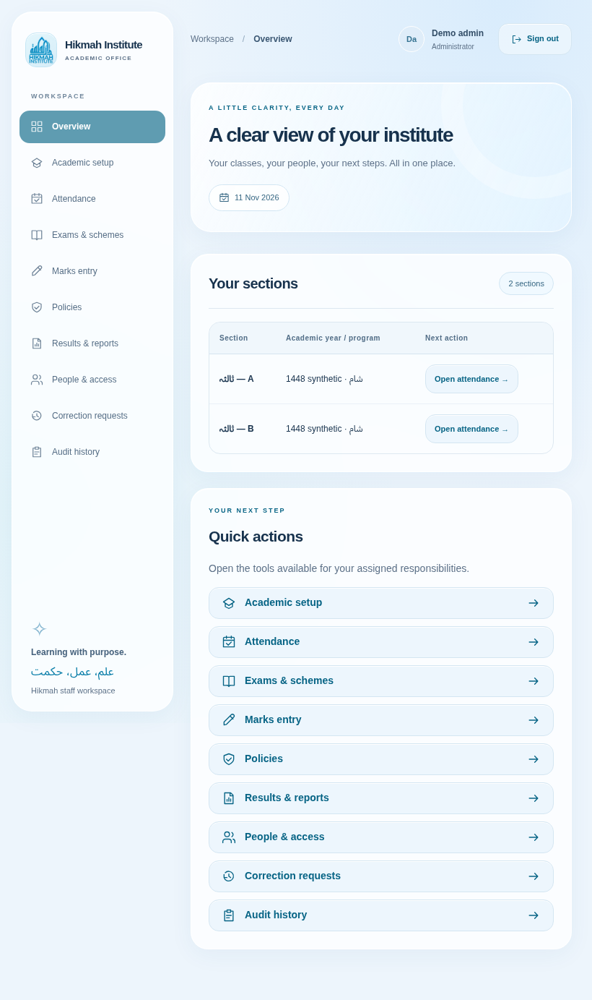

# Institute rules and workflows — 11 November 2026

The user's requirements and two explicit follow-up answers govern this update. They supersede the older blueprint where it used Late, optional class-teacher marks access, or unspecified pass/position rules. Original blueprint files are preserved as references.



## Attendance

The four statuses for new entry are Present, Absent, Half and Leave. Present earns 1, Half earns 0.5, Absent earns 0, and Leave is excluded from the denominator, as confirmed by the institute.

`attendance % = (Present + 0.5 × Half) / (eligible academic days − Leave) × 100`

Only instructional dates marked as counting for attendance are included. Joining/leaving enrollment dates are inclusive; holidays, other non-academic days and future dates are excluded. No weekly holiday pattern is assumed: an administrator or assigned Mushrif explicitly selects teaching weekdays, the range and exceptions in **Attendance → Calendar & multiple dates → Build academic calendar & holidays**. A range update replaces calendar classifications within that range and is audited.

Totals use submitted/locked sheets. Missing or draft dates are unmarked, not implicit absences. Until coverage is complete, the total percentage reads Incomplete rather than presenting a misleading official figure. An all-leave or empty academic period has no numeric percentage and displays N/A. Counts are available independently from the official exam-policy approval flow.

**Attendance totals** offers academic year to date, selected session and previous session. Session windows are explicitly configured in Exams & schemes. Ameer can read and enter attendance only for assigned sections. Mushrif can correct own-class records with a reason; Ameer cannot reopen a submitted sheet. Historical Ameer entry still follows the separately approved edit window. Calendar changes and entry are blocked outside configured academic-year boundaries; future attendance entry is rejected.

Existing `LATE` database records are preserved as legacy data, never silently relabeled Half. New entry rejects Late. Legacy dates must be reviewed and corrected with the actual confirmed status; unresolved legacy records block new official publication. Previously published snapshots and PDF bytes remain unchanged.

## Roles and accounts

| Role            | Access                                                                                                                                                                                  |
| --------------- | --------------------------------------------------------------------------------------------------------------------------------------------------------------------------------------- |
| Administrator   | Institute setup, all classes, accounts/passwords, assignments, calendars, curricula, exams, marks, policies, reports and publication.                                                   |
| Mushrif         | Own assigned classes: attendance/calendar, subjects and six-group curriculum, all subject marks, exam schedules/schemes, review, correction, publication and class/student performance. |
| Subject teacher | Assigned subject papers and marks only; no class attendance or whole-student/whole-class performance.                                                                                   |
| Ameer           | Overview containing assigned sections and attendance shortcuts; Attendance for assigned sections only. No exam, marks, policy, account or student-performance access.                   |

A person can be Mushrif for one class and subject teacher for one or more other classes. Capabilities combine while every operation checks its specific section/paper. A class assignment does not grant whole-class management in a class where the person only teaches a subject. Legacy `CLASS_TEACHER` assignments mean Mushrif; new assignments use `MUSHRIF`. Effective dates and revocation apply on every request.

Create an account or private invitation under **People & access**. Assign class roles and subject offerings under **Academic setup → Enroll learners & assign staff**. Direct administrator password changes and private recovery links are supported. Password changes revoke sessions and audit only the action/reason, never the password. New accounts have no class access until assigned. The last active administrator remains protected.

## Programs, levels, curriculum and sessions

Programs: **صباح** and **شام**. Nine initial levels:

1. پریپ اولیٰ
2. درجہ اولیٰ
3. درجہ ثانیہ
4. درجہ ثالثہ
5. درجہ رابعہ
6. درجہ خامسہ
7. درجہ سادسہ
8. درجہ سابعہ
9. دورہ حدیث شریف

Each program/year/level may have multiple sections, with different subjects between classes. Catalog labels stay editable. The upgrade renames only untouched generic level placeholders, preserving administrator-customized names.

In **Exams & schemes → Class subjects & six groups**, attach subjects and configure the annual class curriculum. Distinct paper codes identify columns even when display labels repeat. Every curriculum/scheme has exactly six nonempty groups and every paper belongs to exactly one group. The sum of paper maxima must equal each declared group maximum. Group names and actual membership remain class configuration, not invented institute-wide subject identities.

Use **Initialize selected session** to reuse the class curriculum in each exam session. Existing marks and approved schemes cannot be overwritten. Codes, offerings and group membership must match the class curriculum across sessions; per-session dates, marks and workflows remain separate. Changes to an approved scheme use its reviewed revision flow and preserve earlier publications. An administrator/Mushrif can seed a missing curriculum from an existing session once. Before changing a curriculum already used by published sessions, review the effect on future revisions; past published documents are retained.

## Marks, passing and positions

Every subject/student/session mark has independent **Exam leave** and **Given on time** fields. Leave/concession makes On time false. Unconfirmed timing stays unknown; missing flags never imply an on-time sitting. A pupil may later receive graded marks after leave or a concession, but remains ineligible for a position in that session. Imports retain existing timing/leave metadata; broader Excel/import improvements remain deferred as requested.

The overall institutional pass minimum is **40%**, inclusive. No per-paper pass threshold has been introduced. Attendance is displayed independently and does not add to or subtract from exam marks.

A position requires all papers graded, every paper explicitly on time, no exam leave/concession, and an unrounded academic percentage **strictly greater than 80%**. Eligible pupils are ranked within their section/session; only the top three positions are displayed. Tied percentages share positions, as confirmed. The proposed policy uses shared competition positions (1, 1, 3); the approval editor also supports shared dense positions (1, 1, 2). Shared ties can award a position to more than three individuals. Display rounding never makes exactly 80% eligible.

The policy editor is prefilled with the confirmed rule values and simple Pass/Fail labels. An administrator must review and approve the complete policy and the class scheme before official publication. Historical edit permissions, reporting windows, scheme identities and any additional grade labels are explicit configuration. Pending, withheld or unknown marks remain blockers; absence/exemption resolution stays explicit rather than silently becoming zero. A new academic year needs its own policy approval records. Closed/archived years retain readable history and reject mark edits until an administrator explicitly reopens the year.

## Reports, promotions and history

**Results & reports → Student performance & history** supports one session, a selected academic year and all academic years. It includes marks, present/absent/half/leave counts, percentage, publication state and positions. Whole-year attendance combines eligible enrollments across class transfers; section details remain visible. Combined year marks are the arithmetic sum of displayed sessions, clearly labeled incomplete where appropriate. No annual grade, weighted exam-session policy or annual position has been invented.

Individual and class PDF exports and class CSV exports are available. Select a session for session-specific class reports, or export the class year. Published sessions use their immutable original result; incomplete live sessions are marked draft. Historical publication eligibility remains under its original policy. The official publication archive still serves the original stored class/individual PDFs.

Mushrif may retrieve complete history for students enrolled in an assigned class. This student-based authorization permits prior years without opening unrelated classes' student lists or full-class reports. Subject-only staff and Ameer are denied these history/export endpoints. When a class assignment expires, its historical-student access is also removed unless another valid assignment authorizes it.

Promotion selects individual pupils into a new academic year's section and creates new enrollments with the same stable student IDs. Earlier enrollment, attendance, marks and publications remain intact. There is no automatic promotion policy or inferred list of passing pupils.

## Upgrade and verify

Keep the original `.env.demo` and database volume. Update the project, then run:

```sh
bash scripts/demo.sh start
bash scripts/demo.sh test
```

Startup applies migration `010_institute_academic_rules.sql`. It preserves previous policy settings for review, removes current approval for the superseded rule set, adds exam flags/curricula and installs the confirmed attendance rule. Review the proposed policy under Policies and approve it before new official result publication. No stored publication or private credential is deleted.

Fresh demos include `admin@hikmah.example`, `admin2@hikmah.example`, `mushrif@hikmah.example`, `teacher@hikmah.example`, `subject@hikmah.example` and `ameer@hikmah.example`. Use the private generated `HIKMAH_DEMO_PASSWORD`. On upgraded demo volumes existing teacher assignments are retained; `subject@hikmah.example` provides the unambiguous subject-only example. The idempotent synthetic seed adds missing demo roles without resetting existing passwords or restoring revoked assignments.

The verification command runs lint, root/web/mobile types, PostgreSQL/PDF/domain tests and web/API production builds. The browser smoke checks all ten administrator views at laptop, iPad and phone widths and verifies Ameer/Mushrif/subject-teacher navigation. Native iOS/Android bundle export is separate from physical-device E2E; institute staging, real-device and operational acceptance remain rollout work.
