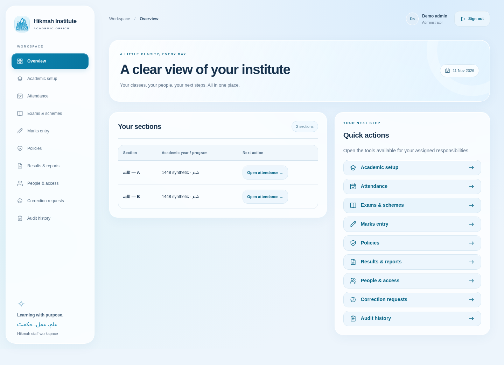
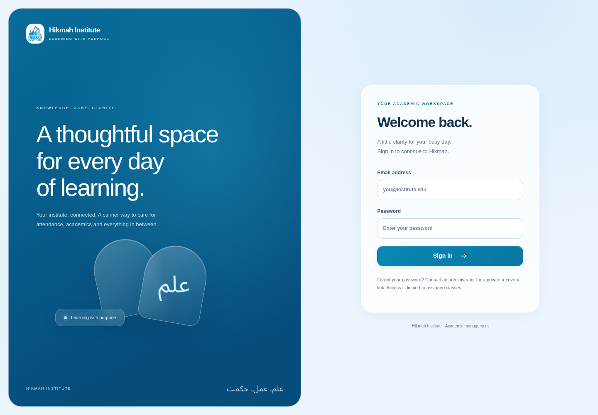

# Blue and white visual theme

The portal now uses a pale blue canvas, frosted white panels, blue accents, rounded controls and restrained shadows. The redesign covers sign-in, account activation/recovery, navigation, the overview, academic setup, attendance grids, schemes, marks, policies, results, staff access, corrections and audit history. It changes presentation and usability, without changing academic policy definitions, approvals or database structure.

## Web

- Shared branding and small decorative navigation icons, an account identity area and clear active-page navigation.
- A responsive sign-in layout and consistent activation/recovery styling. Initial session checking has a branded loading state; new sign-ins return to the overview instead of reopening another user's previous screen. Signing out clears class/cycle selections, and refreshed selections are validated against the current account's scope. Password submission shows pending feedback and prevents duplicate activation submissions.
- Consistent rounded cards, tables, inputs, buttons, notices and disclosure panels. Wide records stay inside horizontal table scrollers rather than widening the whole page.
- A skip link, visible keyboard focus, labeled navigation, semantic status colors, reduced-motion/reduced-transparency preferences and readable surfaces when blur is unavailable.
- No remote fonts, image-generation service or new web dependency is required.

## Expo

The shared `@hikmah/ui-tokens` package defines blue/white colors and radius values. Native screens use translucent white surfaces, rounded controls, subtle shadows, safe-area padding and improved pressed/disabled feedback. Email/password inputs have explicit accessibility labels and keyboard handling keeps the sign-in action usable. Native surfaces do not require platform-specific glass APIs or a blur library.

## Original logo

The original user-uploaded PNG is now included at `apps/web/public/hikmah_logo.png` and detected at build time. It has not been recreated or altered. Replace that exact file and rebuild to update it. Without the asset, a decorative academic mark and the institute name are shown. See [the Mac logo instructions](MACOS-APPLE-SILICON.md#use-your-original-logo).

## Verification

Use `bash scripts/demo.sh test` for lint, type checks, the 31 domain/database/PDF tests and production builds. With an API/web instance running and a private demo password supplied via the environment, `scripts/browser-smoke.ts` exercises login, attendance, raw result preview, policy editing, all ten screens at 1440/1024/820/768/390/320px, keyboard navigation, sign-out and activation. Screenshots remain in ignored `.data/screenshots/`.

Expo iOS/Android bundle export verifies module integration; it does not establish physical-device UI or native E2E acceptance. The uploaded institute PNG was subsequently verified in the running web interface. Official policy sign-off and the remaining rollout gates in the implementation record remain outstanding.
